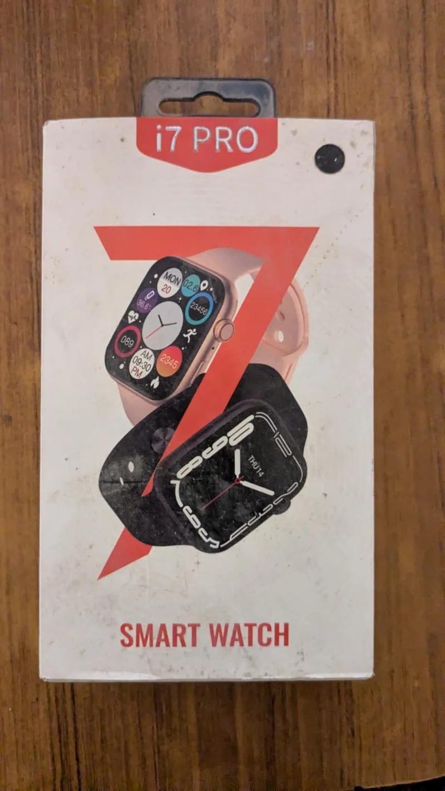
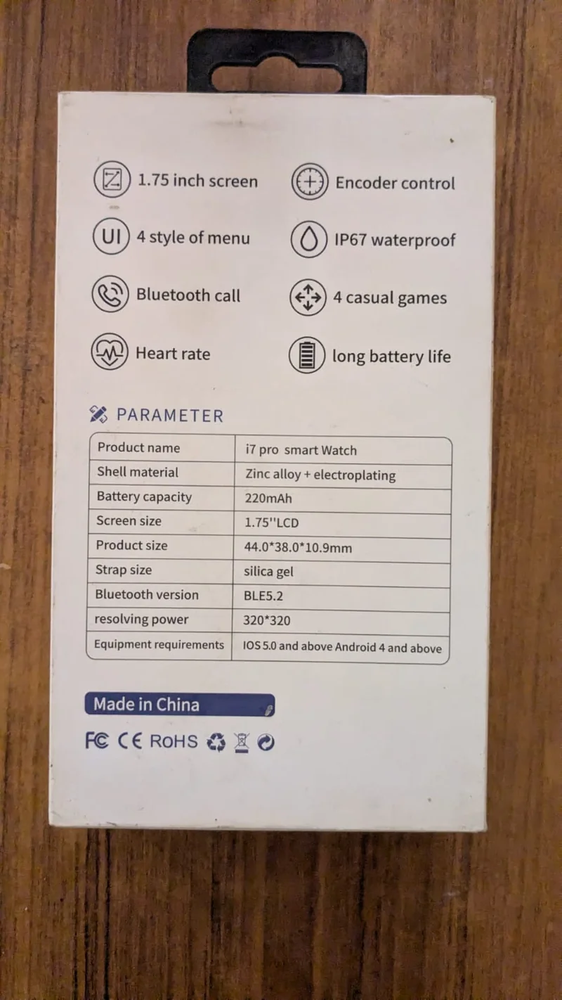
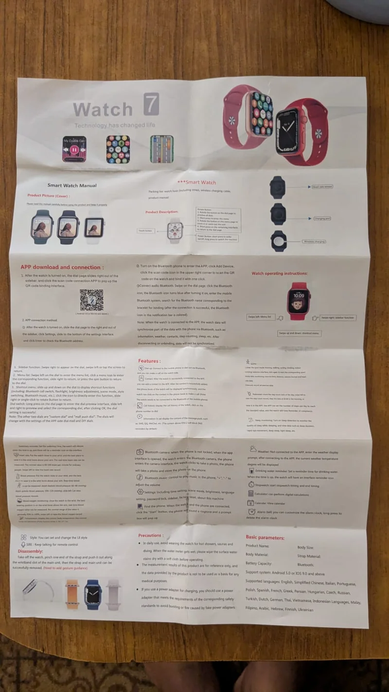
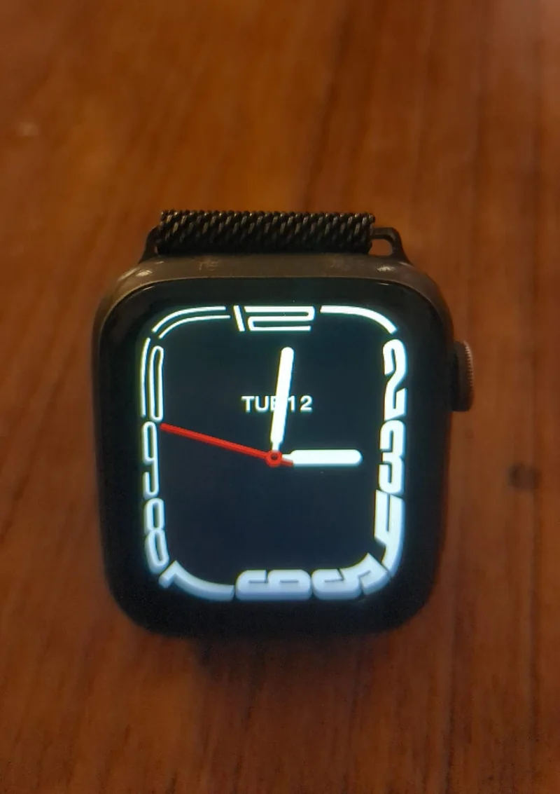

# WristLab — D Watch 7 Decoded Studio

A reverse-engineered studio for the Chinese D Watch7: live BLE telemetry, a protocol lab, 20 browser games, and the full decoding story.

<table>
  <tr>
    <td></td>
    <td></td>
    <td></td>
    <td></td>
  </tr>
</table>

## Features

- **Live dashboard** — BLE status, battery, heart rate, SpO₂, blood pressure, one-shot HR trace.
- **20 games** on one shared canvas engine, playable with keyboard, pointer, or the watch's media buttons.
- **Protocol lab** — haptic-free command console: sensors, notifications, time sync, dial codes, raw DF frames, event log.
- **Full decode** — verified protocol, hardware spec, merged findings, OTA notes, the narrative.
- **Manage** — settings, per-game stats, export, reset, the three-step recipe for adding a game.

The watch's motor is a buzzer that blocks the BLE link for 30–60 s after a single command, so the studio does not use it. The protocol command is documented; the feature is not shipped.

## Quick start

```bash
pip install -r requirements.txt
python dashboard_server.py
```

Then open `http://127.0.0.1:8080`. Everything works with no watch attached (keyboard/pointer fallback, offline state labelled).

Windows one-click: `start.bat`.

## Verify

```bash
npm install
npx playwright test
```

23 checks: SPA shell, arcade shell, arcade theme, dotfile/CORS handling, every game's start-to-gameplay path.

## Structure

```
index.html          SPA shell, hash router
assets/app.js       router, bridge, views, icon map (Font Awesome 5 Free)
assets/app.css      design system, route-scoped accents
games/engine.js     dependency-free canvas runtime
games/registry.js   single source of truth for the 20 games
games/*.html        one self-contained file per game
dashboard_server.py HTTP, WebSocket, BLE bridge
docs/               verified protocol, spec, OTA, merged findings
DECODED.md          the full reverse-engineering story
```

## Hardware

D Watch 7, Freqchip Fr-BLE-1.0, firmware 6.1.2, MAC `C2:FC:01:BC:D4:1F`. Sold under many names (the retail box reads "i7 PRO"). The watch cannot run code; the browser is the console, the watch is the controller.

## Adding a game

1. Copy `games/template.html` to `games/my-game.html`.
2. Write `update(g, dt)` and `draw(g, ctx)`.
3. Add one object to `games/registry.js`.

The arcade, search, filters, high scores and manager pick it up automatically.

## Docs

`docs/PROTOCOL.md` (master protocol), `docs/WATCH_SPEC.md` (hardware, evidence-graded), `docs/MERGED_PROTOCOL_AND_FINDINGS.md`, `docs/OTA.md`, `docs/CONTEXT.md`, `DECODED.md`.

## Watch buttons not responding?

The watch sends its three media buttons (Prev / Play / Next) over AVRCP to a Windows media player. The studio registers itself as "D Watch7 Lab". If pressing a button does nothing:

1. Open the watch's Music screen (buttons only emit there).
2. Make sure the watch is paired to this PC as an audio device.
3. In the Protocol Lab, click **Sim left / Sim action / Sim right**. If those move the game, the server-to-browser chain is fine and the issue is watch-to-PC pairing.
4. Check the server console for `Watch Button:` lines. If none appear, Windows is not delivering the media key to "D Watch7 Lab" — close other media players (Spotify, etc.) and retry.
5. The watch button action defaults to "game" (media keys → left/action/right). In BP mode it triggers a blood-pressure read instead.

MIT. Reverse-engineered, not redistributed firmware.

## License

MIT. Reverse-engineered, not redistributed firmware.
